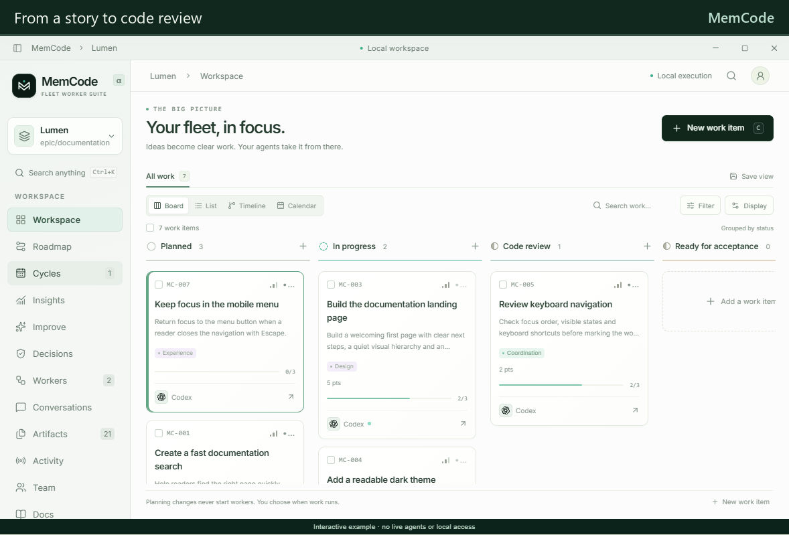

<p align="center"></p>
<h1 align="center">MemCode</h1>
<p align="center"><strong>One board for the coding agents you already use.</strong></p>
<p align="center"><a href="https://www.memtrace.io/memcode#downloads">Download the desktop beta</a> &nbsp;·&nbsp; <a href="https://www.memtrace.io/memcode#walkthrough">Try the interactive demo</a> &nbsp;·&nbsp; <a href="https://www.memtrace.io/docs/memcode/getting-started">Getting started</a></p>

Plan the work, hand it to the coding tools you already use, and review what they did, all on your own computer. Claude Code can fix a bug while Codex builds the next feature and you review what Cursor changed. Each task keeps its conversation, changes, results and review together, so you can open a card and pick up where the worker left off.

[](https://www.memtrace.io/memcode#walkthrough)

### How it works

1. **Say what you want.** Choose **New work** or press **C**: “Pressing Escape should close the mobile menu and return focus to the button.” Your connected worker reads the code and plans it. A small fix becomes a quick change, bigger work becomes a goal with a few tasks, and separate outcomes become separate goals. If a goal is already changing the same code, the new work joins it. Check the plan, change anything you like, then add it, or add it and start.
2. **Let the workers run.** Each task goes to a worker picked for how complex its code is, or to the worker and model you choose. Tasks in a goal run side by side and stay coordinated, so they don't step on each other.
3. **Review what changed.** Move a finished task to **Code review**. Open a finding at its line, compare the code before and after, and see which checks ran. Ask the reviewer a question, send fixes back to the worker, or accept the task.
4. **Ship the goal.** When the tasks you worked on are reviewed, ship them together. The goal stays open for the rest. MemCode shows every step before it runs and does nothing until you click.

A **goal** is an outcome you want, like “Customers can export reports”. A **task** is one piece of work a worker does. **Quick changes** are small tasks that ship together. **Cycles** are optional timeboxes that can hold work from many goals.

Under the hood, each goal gets its own branch and workspace and ships as many pull requests as it needs. [How goals work](docs/goals.md) covers branches, shipping and keeping goals up to date.

### Smart routing and measured code review

**Give each task the model it needs.** MemCode measures complexity and nesting in the relevant code, traces what the change could affect, and picks a model and reasoning effort from your connected workers. Straightforward changes can use lighter models; complex work gets stronger reasoning. Check the recommendation or choose your own worker and model.

**See what the change did to code quality.** Memtrace parses the actual source and compares the same functions before and after: maintainability, cognitive and cyclomatic complexity, and nesting. Review findings include source locations, detector evidence and affected code. Recorded checks stay tied to the reviewed source snapshot. Open a finding, ask the reviewer about it, or send selected fixes back to the worker before accepting the task. The review keeps measurement coverage visible and final acceptance in your hands.

### Start building

| | Available in the open beta |
|---|---|
| Desktop | macOS 13.5+ on Apple Silicon · Windows 10/11 on x64 |
| Coding workers | Claude Code · Codex · Cursor · GitHub Copilot · DeepSeek Harness, using your existing provider accounts |
| Team projects | Share the board, comments and published results. Each developer runs workers locally and exchanges code through Git. |
| Linear | Keep a team's issues, goals and cycles in step with the board, both ways. [How it works](docs/linear.md) |

Install MemCode, sign in to Memtrace, choose your project folder and connect a worker. The installer includes Memtrace. The noncommercial beta includes unlimited local Memtrace analysis. Your coding provider handles model usage. The shared live agent browser currently runs on Windows.

**On the roadmap** · Jira and other issue and sprint trackers, so teams can bring work from the boards they already use.

[Set up a team](docs/team-quickstart.md) · [How goals work](docs/goals.md) · [Read a code review](docs/story-code-review.md) · [Keyboard shortcuts](docs/keyboard-shortcuts.md) · [How routing works](docs/routing-measurement.md)

<details>
<summary><strong>Run MemCode from source</strong></summary>

Install Git, Node.js 22.12+, Rust 1.90+ and the Tauri prerequisites for your platform. On Windows you'll need MSVC Build Tools and WebView2. On macOS start with the [developer quickstart](docs/macos-development.md).

```sh
npm ci
npm run dev
```

The interface reloads as you edit. Finish active workers before restarting the desktop runtime. See [contributing](CONTRIBUTING.md) for the build and release workflow.

</details>

MemCode is available for noncommercial use under [PolyForm Noncommercial 1.0.0](LICENSE). Commercial use, including internal company development, requires a separate license. The bundled Memtrace engine is licensed separately. [Licensing](docs/licensing.md) · [Third-party notices](THIRD_PARTY_NOTICES.md)
