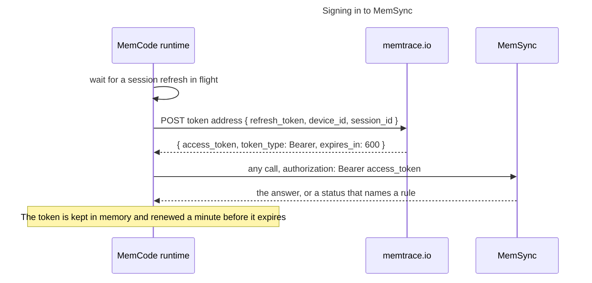
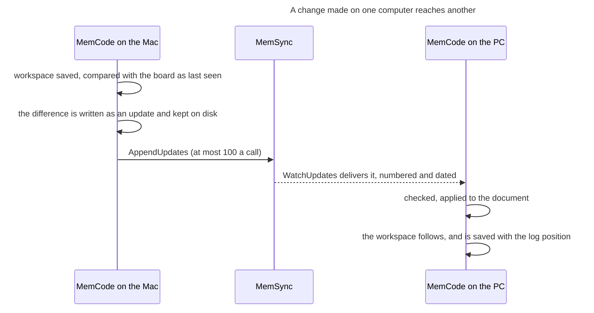

# Shared projects

MemCode can sign in to MemSync, the service that is to replace Team Sync, show the
projects a person shares, and keep the board of a connected project the same on every
computer that connects to it. This page says what exists, how to turn it on and how to
try it on one computer.

Nothing is deployed. Until two addresses are entered in Settings, none of this is in the
app: no sidebar entry, no request to anyone. Team Sync is unchanged and keeps working
beside it.

## What it does today

- Signs in to MemSync with the Memtrace account MemCode is already connected to.
- Lists the shared projects the person owns or is a guest on, and the invitations waiting
  for them.
- Accepts an invitation.
- Connects the open project to one shared project, and disconnects it.
- Keeps the board of a connected project in step with the shared project: goals, cycles,
  tasks with their runbooks, comments, lanes, custom fields and saved views. See
  [Keeping the board in step](#keeping-the-board-in-step).
- Shows what happened on a card to everyone on the project: the worker's conversation,
  what it is doing, its code review, and the files and changes someone shared from the
  card, with who did each. See [What happens on a card](#what-happens-on-a-card).
- Opens the MemCode tab of the Memtrace account, where projects are started, renamed and
  deleted and people are invited.

Workers run only on the computer that started them. Source changes travel through Git.

A project is the thing people share. There is no team. A person's own computers are never
invited: signing in to MemCode on each is enough, and each then connects its own local
project to the same shared project.

## Turning it on

Settings → Account → **Advanced · sharing service** has two fields.

| Field | What goes in it |
| --- | --- |
| Sharing service address | Where MemSync is. `https://` anywhere. Plain `http://` only for `127.0.0.1`, `localhost` or `[::1]`, because MemSync speaks unencrypted HTTP/2 and every call carries an access token. A path is kept, for a proxy that serves MemSync under one. |
| Sign-in address for sharing | Where MemCode exchanges its Memtrace sign-in for a MemSync access token. It must be at `https://www.memtrace.io` or on this computer. |

Both empty: sharing is absent. One without the other, or an address that cannot be used,
is refused when Settings is saved, with a sentence that says why. Once both are saved,
**Sharing** appears in the sidebar.

The sign-in address is limited to memtrace.io because the request carries the session's
refresh token, and the only session MemCode holds is a memtrace.io one. A self-hosted
MemSync will need its own way to sign in before this rule can widen.

When MemSync is deployed, the hosted addresses should become the default, so nobody has to
type them.

## How MemCode signs in



- The three values are the ones MemCode sends to `/api/memcode/beta/refresh`. Nothing is
  spent, so a lost reply is asked for again.
- A refresh spends the refresh token. MemCode waits for one in flight before the exchange,
  and when memtrace.io still answers 401 it looks at the session once more and tries again
  only if the refresh token has changed since.
- The token belongs to one sign-in. Signing out, or signing in as someone else, stops it
  being used at the next call.
- When MemSync turns a token away, MemCode asks for a new one and makes the call once
  more. A second refusal is shown as "did not accept this sign-in", which is what a
  signing key published in the last five minutes looks like.
- Neither the session nor a token is written to `workspace.json` or sent to the window.

## Connecting a project

A link is kept on this computer, in `sharedProjectLinks` in `workspace.json`: the local
project, the shared project and its name when last seen, the account that connected it,
the sharing service it lives on and when.

- A local project is connected to one shared project, and a shared project to one local
  project on a computer.
- The example project cannot be connected, and neither can a project that is shared
  through Team Sync. Two services must not both keep one board in step.
- Connecting asks MemSync whether the person is on that shared project. Disconnecting
  asks nothing: it forgets the link here, and the person stays on the shared project.
- A link whose shared project was deleted, or that was made under another account or on
  another sharing service, is shown as such and can be disconnected.

## Keeping the board in step

The board the app shows is still the workspace file. For each connected project MemCode
also keeps a Yjs document, laid out as
[The board as one Yjs document](shared-board-layout-proposal.md) describes. MemSync holds
the log of changes to it and never reads one.



- **Starting.** Sync runs for a project when its link belongs to the account that is
  signed in and to the sharing service in Settings. It starts with MemCode, after
  connecting, and when the sign-in or the addresses change.
- **The first time.** You either share your own project or join someone else's and get
  their board. A computer whose board has work on it writes the board to a log that has
  none, one entry an update. A computer whose project has no work takes the board from the
  log as it is, lanes, custom fields and saved views included. When both have work,
  nothing is merged: Connect answers with one sentence that says so, and the project stays
  unconnected. One board on two computers, with the same ids, is one board.
  Two computers that both find the log empty in the same seconds both write their board.
  That gap is known and stays for now. Closing it needs a field in MemSync.
- **Changes made here** are found after every save of the workspace, and once when sync
  starts, which is how changes made while signed out are sent later. They wait on disk
  until the log has them.
- **Changes from others** are read page by page and then from a stream that stays open.
  When the stream ends, MemCode reads on from the last entry it dealt with. A task that
  arrives never starts a worker.
- **Offline.** Changes are kept and sent when the service answers again. MemCode tries
  again after 1, 2, 5, 15, 30 and then every 60 seconds.
- **Two changes at once.** Different tasks, or different parts of one task, both stay.
  Two changes to the same field end with one of the two, the same on every computer. A
  description is merged, so edits in different places both stay.
- **An update that cannot be used** is left out and said so, and reading goes on. See the
  layout page for what that means for the changes after it.
- **Two tasks with one identifier**, as when two computers both made MC-014 while apart:
  the one that reached the log first keeps it, and the other gets the next free number.
- **A newer layout.** A board written by a newer MemCode is shown and not changed.
- **Disconnecting** ends sync for that project and deletes what was kept for it. The
  board stays on the computer.

What is kept is in the profile, under `shared-boards/`, one folder per connected project:
`log.bin`, the document as the log has built it, and `sync.json`, with the log position,
the board as last seen, the changes not sent yet and the entries left out. Neither holds
a token or anything a worker wrote.

The Sharing view says how the open project's board stands:

| State | What the person reads |
| --- | --- |
| Reading the log | Reading the shared board… |
| Nothing waits | The board is in sync. |
| Changes on their way | Sending 3 changes to the shared board… |
| The service cannot be reached | The reason, and "3 changes made here are kept on this computer and sent when it works again." |
| The project has work, and so has the shared board | "website already has work of its own, so it cannot join Website board: connect a project that has none yet." Connect answers with it and connects nothing. It is on this line only when the service could not be asked while connecting. |
| A newer MemCode laid the board out | A newer MemCode laid this board out. Update MemCode to change it from this computer. Until then it is shown here and what you change stays on this computer. |
| The shared project is gone for this person | This shared project no longer exists, or you are no longer on it. |
| The workspace cannot be saved | The workspace could not be saved, so changes from the shared board are waiting. Free disk space, and they are taken up again. |

Below that line, when there is something to say: "2 changes from Dana Ek on 21 November
could not be read and were left out.", "Some changes are set aside until one they build on
arrives." and "1 value is too large for the sharing service and stays on this computer."

## What happens on a card

Each card of a shared project has an activity log at MemSync (its ADR-0014). MemSync never
reads it; what an entry holds is MemCode's (`runtime/sharing/cards/entries.ts`).

On the computer that runs a worker on a card, MemCode writes the run to the card's log as
it happens, at most once a second: its state, what it is doing, the models, the person's
and the worker's turns, and its code review. That is what Team Sync shares, and nothing
more: tool output, local references and review notes stay on the computer, and paths in a
home folder and tokens are blotted out of the text.

On every other computer, a card that is opened is read from its log and followed while it
is open. A run from another computer is shown with the views MemCode has for a worker
elsewhere:

- the card header says "On Mac";
- the conversation shows the person's turns as "Alex Holm · Mac" and the worker's turns;
- the status line above the message box says "Alex Holm · Mac" and what the worker is doing;
- the worker panel says SHARED, the harness, whose computer, and "Conversation and review
  shared with the project. It runs on Mac.";
- the Code review tab shows the run's review;
- the message box says "This worker runs on Alex Holm's Mac. Comment on the card to reach
  them." and sends nothing. Starting a review or asking the review a question is refused
  the same way. Comments reach everyone.

A run shows only what the account that started it wrote. A turn or a review that someone
else on the project writes into it is not shown. A computer never shows its own run back
to itself, and a run started here takes over the card.

**Files and changes are shared on purpose**, as in Team Sync. On the computer that ran the
worker, the Artifacts tab lists the card's files with a **Share** button each, and the
Changes tab has **Share changes**. A file is at most 5 MB, and a project keeps at most 50 MB.
On other computers, a shared file is listed among the card's files with who shared it, and
opening it fetches it beside the card; shared changes show in the Changes tab.

What a computer sent and what still waits is in `cards.json` in the board's folder, so a
restart sends only what is new and nothing is lost offline. The computer's own id for card
logs is in `shared-boards/computer.json`.

## What a person is told

MemSync names the rule that turned a request down in `memsync-refusal` metadata. The
sentences are MemCode's own, in `src/sharing-refusals.ts`. A test fails when a rule has no
sentence.

| Rule | Sentence |
| --- | --- |
| `no_such_project` | This shared project no longer exists, or you are no longer on it. |
| `no_such_invitation` | That invitation is no longer open. Ask the owner of the project to invite you again. |
| `no_such_guest` | That person is not a guest on this project. |
| `only_the_owner_invites` | Only the owner of a project can invite people to it. |
| `not_the_owner` | Only the owner of a project can change it. |
| `the_owner_cannot_leave` | You own this project, so you cannot leave it. You can delete it at memtrace.io. |
| `guest_limit_reached` | Every guest place on this project is taken. An invitation holds its place until it is accepted, cancelled or expires. |
| `already_on_project` | You are already on this project. |
| `already_invited` | That email address already has an open invitation to this project. |
| `invitation_expired` | This invitation has expired. Ask the owner of the project to send a new one. |
| `email_not_verified` | Invitations go to a verified email address, and the one on your Memtrace account is not verified. Verify it at memtrace.io, then accept again. |
| `invalid_project_name` | A project name is one line of text, at most 240 characters long. |
| `invalid_email` | That is not an email address. Check it and try again. |
| `invalid_update_id` | MemCode sent a board change without a usable id. This is a fault in MemCode, not something you did. |
| `empty_update` | MemCode sent an empty board change. This is a fault in MemCode, not something you did. |
| `update_too_large` | One change to the board was too large to share. Shorten the text you just added and try again. |
| `too_many_updates` | MemCode sent too many board changes at once. This is a fault in MemCode, not something you did. |
| `invalid_card_id` | MemCode named a card the sharing service cannot use. This is a fault in MemCode, not something you did. |
| `invalid_file` | That file cannot be shared. An empty file is not kept. |
| `file_too_large` | That file is larger than 5 MB, which is the most a project can share in one file. |
| `project_storage_full` | This project already shares 50 MB of files, which is all it can keep. The file stays on this computer. |
| `no_such_file` | That file is no longer kept for this project. Ask whoever shared it to share it again. |

The last four belong to the board log. MemCode is written so that it never meets them:
ids are made from the bytes, nothing empty is sent, a change is cut into pieces well under
the limit and a call holds at most 100. If the service names one anyway, sync for that
board stops with the sentence. `already_on_project` is worded for accepting, the only call
of MemCode's that can meet it.

Other problems have a sentence each as well:

| When | Sentence |
| --- | --- |
| Nobody is signed in | Sign in to Memtrace to see the projects you share. |
| memtrace.io no longer knows the session | Your Memtrace sign-in has ended. Sign in again to see the projects you share. |
| memtrace.io answers 422 | The name or email on your Memtrace account cannot be used for sharing. Change it at memtrace.io, then try again. |
| memtrace.io answers 503 | Sharing is switched off or not set up at memtrace.io right now. Try again later. |
| MemSync cannot be reached | The sharing service could not be reached. Check your connection and try again. |
| MemSync is too slow | The sharing service did not answer in time. Try again in a moment. |
| MemSync answers with trouble of its own | The sharing service is having trouble right now. Try again in a few minutes. |
| MemSync refuses the token twice | The sharing service did not accept this sign-in. Try again in a few minutes. |
| The address is not a MemSync | The sharing address did not answer as a sharing service. Check it in Settings. |
| A reply cannot be read | The sharing service sent a reply MemCode could not read. Updating MemCode may help. |
| A rule MemCode does not know | The sharing service turned this down for a reason this version of MemCode does not know. Updating MemCode may help. |

The call, the status and MemSync's own words go to the runtime's log on a line that starts
with `[sharing]`.

## Where the code is

| Piece | File |
| --- | --- |
| The use cases: overview, accept, connect, disconnect, and which boards sync | `runtime/sharing/sharing.ts` |
| Requests the window may make, and what Settings may save | `runtime/sharing/routes.ts` |
| The two addresses and their rules | `runtime/sharing/addresses.ts` |
| The access token: exchange, renewal, one retry | `runtime/sharing/access.ts` |
| The session shown to memtrace.io | `sessionProof` in `runtime/beta.ts` |
| Problems a person can be told about | `runtime/sharing/problems.ts` |
| MemSync's Projects API as MemCode uses it | `runtime/sharing/memsync/projects-api.ts` |
| MemSync's Boards API as MemCode uses it | `runtime/sharing/memsync/boards-api.ts` |
| A call signed with the access token, once more when the token is refused | `runtime/sharing/memsync/signed-calls.ts` |
| Board sync for one project: reading, sending, bringing two boards together | `runtime/sharing/board/sync.ts` |
| The board as a Yjs document | `runtime/sharing/board/document.ts` |
| What of a project is on the board, and what a board means for the project | `runtime/sharing/board/board.ts` |
| Update ids, the check before applying, what a document holds beyond the log | `runtime/sharing/board/updates.ts` |
| Who keeps an identifier two tasks share | `runtime/sharing/board/identifiers.ts` |
| What a connected project keeps on disk | `runtime/sharing/board/store.ts` |
| How a board stands, in words | `src/sharing-board.ts` |
| What MemCode writes into a card's log | `runtime/sharing/cards/entries.ts` |
| Writing this computer's runs, following an open card | `runtime/sharing/cards/activity.ts` |
| Which of a task's files may be shared | `runtime/sharing/cards/files.ts` |
| MemSync's Cards API as MemCode uses it | `runtime/sharing/memsync/cards-api.ts`, `cards-contract.ts`, `cards.proto` |
| A run from a card's log, in the shape the card's views take | `src/sharing-cards.ts` |
| The Share buttons on a card's files | `src/components/ShareFromCard.tsx` |
| gRPC over Node's own HTTP/2 | `runtime/sharing/memsync/grpc.ts` |
| Protocol Buffers on the wire | `runtime/sharing/memsync/wire.ts` |
| The contract, and the part of it MemCode uses | `runtime/sharing/memsync/projects.proto`, `projects-contract.ts`, `boards.proto`, `boards-contract.ts` |
| Rule names and sentences | `src/sharing-refusals.ts` |
| What the window knows of sharing | `src/sharing.ts` |
| The Sharing view, and the fields in Settings | `src/components/SharedProjects.tsx`, `SharingSettings.tsx` |
| The page that opens at memtrace.io | `open_memcode_projects` in `src-tauri/src/native.rs` |

MemCode makes four of the Projects calls, `ListProjects`, `ListInvitations`, `GetProject`
and `AcceptInvitation`, all three Boards calls, `AppendUpdates`, `ReadUpdates` and
`WatchUpdates`, and all five Cards calls. A Cards reply can be 6 MiB, so the client takes
replies that large.

One package was added: `yjs` 13.6.33, with `lib0` and `isomorphic.js` that it needs. They
are in the lock file and in the third-party notices. The gRPC client is still MemCode's
own, over `node:http2`, because the app otherwise has no gRPC dependency. The contract
files are written by hand; `tests/sharing-wire.test.ts` reads the `.proto` files and fails
when the two disagree, and checks the codec against bytes made by `protoc`.

### When the contract changes

`runtime/sharing/memsync/projects.proto` and `boards.proto` are copies of the files in
`proto/memsync/v1/` in the `memsync` repository, taken on 21 November 2026. Copy the newer
file over it and run:

```sh
node --import tsx --test tests/sharing-wire.test.ts
```

The test names every message and call that no longer matches.

## Checks

```sh
node --import tsx --test tests/sharing*.test.ts
```

One file runs MemCode's client against a real `memsync-server`. It is skipped unless both
variables are set:

```sh
MEMSYNC_SERVER_BINARY=/path/to/memsync/target/release/memsync-server MEMSYNC_TEST_DATABASE_URL=postgres://memsync@127.0.0.1:54329/postgres node --import tsx --test tests/sharing-real-memsync.test.ts
```

`MEMSYNC_TEST_DATABASE_URL` names a PostgreSQL server where tests may create databases,
as in the `memsync` repository. The test makes a database of its own with `psql` and drops
it, so nothing that already exists there is touched. Never point it at a server that holds
real data. `MEMSYNC_TEST_PSQL` names another `psql` when the one on the PATH will not do.

The same scenarios run against a stand-in service in `tests/support/memsync-stand-in.ts`
on every `npm test`. Eleven of the thirteen project rules are reached against the real
server. `invitation_expired` is reached only on the stand-in, where days can be made to
pass, and `the_owner_cannot_leave` nowhere, because MemCode never asks to leave.

Board sync has nine scenarios with two computers that run against both: a board written
out and taken by a second computer, a goal, a cycle and a task made on one showing on the
other while both run, changes in both directions, offline and a restart,
changes made while sync was not running, two boards that stay two, two tasks numbered
alike, and a guest who is taken off the project. Sixteen more run against the stand-in only,
most because they need a service that can be made to misbehave: an answer that is lost,
an update damaged in the log, bytes that are not what their id says, an update that reads
and cannot be applied, a newer layout, a change the service refuses, a call it never
answers, MemCode stopped before and after the workspace file was written, a full disk and
a stream that is cut. `tests/sharing-runtime.test.ts` runs two whole runtimes against the
stand-in, through the same requests the window makes.

43 deliberate breakages of board sync were run against these tests. 42 make a test fail.
One is not caught: the line in `runtime/app.ts` that hands board sync the workspace save.
What that line relies on, that `LocalStore.save` reads the workspace at the call and
writes it after the step it is given, is covered in `tests/sharing-workspace-save.test.ts`.

What happens on a card has five Cards client scenarios and eight card activity scenarios,
which run against the stand-in and against a real `memsync-server` that serves Cards
(the one built on 22 November does): entries numbered and signed per card, a watched card,
a 5 MB file in one reply, every refusal by its rule name, the 50 MB limit; a run shown live
on the other computer with who runs it, only what changed sent again, the review, a turn
and a review forged by a guest not shown, the same person on two computers, offline and a
restart, a shared file, and a task whose id is not a UUID. Two whole runtimes check that a
card opened on the PC shows the Mac's run and that nothing can be sent to it.

## Trying it on one computer

`scripts/shared-projects-local.mts` runs the real runtime and the real app window in a
browser, signed in through a memtrace.io on the same computer.

What is real: the runtime, its beta sign-in and refresh, the token exchange, the calls to
`memsync-server` and the app's own screens. What stands in: the native shell, whose calls
the script answers; the person in the browser, whose approval the script gives with a
session cookie; and the code engine, which is switched off so that nothing is downloaded
and no installed Memtrace is touched.

1. Start a throwaway PostgreSQL and create two databases, one for the site and one for
   MemSync.
2. Run memtrace.io from a branch that has `POST /api/memcode/memsync/token`, with
   `MEMCODE_BETA_ENABLED=1` and a signing key. The `memtrace` repository describes this in
   `memtrace-ui/docs/memsync-access-tokens.md` and `memcode-projects.md`.
3. Start `memsync-server` after the site, with `MEMSYNC_TOKEN_KEYS_URL` set to the site's
   `/api/memcode/jwks`.
4. Give the site a signed-in, approved person: a `user`, an approved `app_users` row and a
   `session`, as `e2e/seed.mjs` in `memtrace-ui` does. Their signed session cookie is what
   the script needs.
5. Start MemCode:

   ```sh
   MEMCODE_LOCAL_SITE=http://127.0.0.1:3000 MEMCODE_LOCAL_SITE_COOKIE=<cookie value> node --import tsx scripts/shared-projects-local.mts --port 5310
   ```

6. Open the address it prints. Choose **Connect Memtrace beta** under Account in Settings,
   then enter the sharing service address and the token address the script printed.

A second run on another port, with another `--profile` folder, is a second computer. Sign
it in as the same person, connect its project to the same shared project in the Sharing
view, and what is done on one board shows on the other. A run with another person's
cookie is a guest's computer, once that person has accepted an invitation.

Stopping `memsync-server` shows the offline line and the count of changes that wait.
Starting it again sends them, within a minute.

To try what happens on a card without running a model, start the computer that runs the
worker with `--stand-in-worker`. It adds `POST /dev/worker-turn`, which plays a worker on a
task: `{ "taskId": "…", "text": "…", "state": "running" | "finished", "file": { "name":
"report.html", "text": "…" } }`. Open the card on the other computer and watch it follow.
In this browser run an HTML file shows a blank preview on both computers: the native shell
draws HTML previews, and the script stands in for it.

## Choices that are not confirmed

1. **Where sharing sits.** Its own sidebar entry, shown only once the addresses are set.
   It is next to Team until Team Sync goes.
2. **The addresses are typed in Settings**, under an Advanced section of Account. Until
   MemSync is deployed there is no default to ship.
3. **The sign-in address must be at www.memtrace.io or on this computer.**
4. **No new package.** gRPC and Protocol Buffers are written against Node's own HTTP/2,
   and checked against the `.proto` file. The website uses Connect.
5. **One local project per shared project on a computer, and one shared project per local
   project.**
6. **A project in Team Sync cannot be connected** until it has left its team.
7. **Disconnecting is local.** It does not leave the shared project. MemCode has no leave.
8. **The window is given names only.** Account ids and email addresses of other people
   stay in the runtime.
9. **Every sentence** on this page and on the screens.
10. **Ten seconds** of patience for a MemSync call and fifteen for the token exchange.
11. **A token is renewed a minute before it expires**, or at half its life when it lives
    under two minutes.
12. **The page that opens at memtrace.io** is `/account?workspace=all&section=memcode`,
    which is where the MemCode tab was put on its own branch. The address is fixed in the
    native shell.
13. **The local-run script is in the repository**, with a stand-in for the native shell.

For board sync, beside what the [layout page](shared-board-layout-proposal.md) holds:

14. **Sync starts by itself** for every connected project. There is no switch per project
    other than Disconnect.
15. **Where the board is kept on disk**: `shared-boards/` in the profile.
16. **Where a project and the log hold an entry with the same id, the log's is taken.**
    That is one board on two computers, or a project that is connected again.
17. **Connect waits up to eight seconds** for board sync to say how the two boards stand,
    and takes the link back when both have work. When the service cannot be asked in
    that time, the link stays and the Sharing view says it later.
18. **A project that joins takes the board's lanes, custom fields and saved views** in
    place of its own.
19. **How long MemCode waits before trying again**: 1, 2, 5, 15, 30, then 60 seconds.
20. **A comment in a connected project is by the Memtrace account**, with the name the
    sharing service has for it. Before, it was by "You".
21. **A task that a worker on this computer is on is not taken off the board here** when
    someone else deletes it. It is back for everyone once it changes here.
22. **Every sentence** in the table of states above.

For what happens on a card:

23. **A card is read when it is opened and followed while open**, not for every card all
    the time. The board does not show who is running what across the project.
24. **Files and changes are shared with one click each**, not on their own, as in Team Sync.
    Shared changes are a file of the Changes tab's own format, not a Git patch.
25. **A run's turns and review count only from the account that wrote its first entry.**
26. **The person's turns of a run from elsewhere carry the run owner's name.**
27. **This computer is named by its kind, "Mac", "Windows" or "Linux"**, never its host name.
28. **A run is written at most once a second**, so a long streamed answer is sent a few
    times over as it grows.

## Not built

- **Messages to a worker on another computer, claims, and who is running what across the
  project.** The next step, with MemSync's ADR-0006. Until then a person continues a task
  on another computer with a worker that starts fresh there, from the card's brief,
  runbook, comments and shared changes, not from the first computer's conversation.
- **Hiding a review or a file that someone else on the project shared into a card.** A
  file shows who shared it; it is not refused.
- What the [layout page](shared-board-layout-proposal.md#not-built) lists for the board.
- Running a worker on someone else's computer. MemSync has nothing for it.
- Leaving a shared project from MemCode.
- Anything for organization projects. MemSync has none yet.
- Moving a Team Sync project to a shared project.
- A default address. It needs a deployed MemSync.
- A notice in the app when an invitation arrives. The Sharing view shows it when opened.
