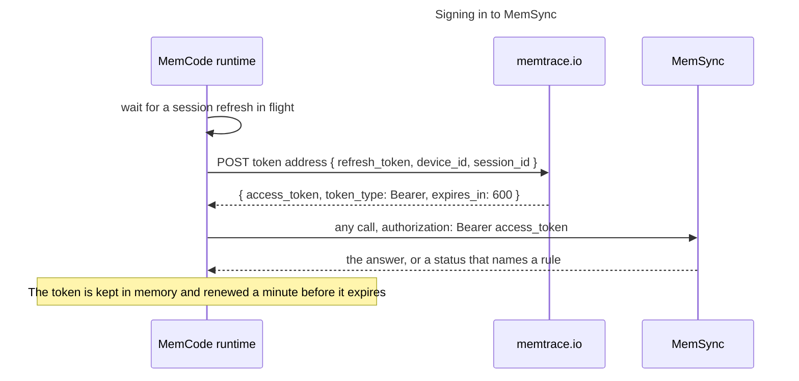
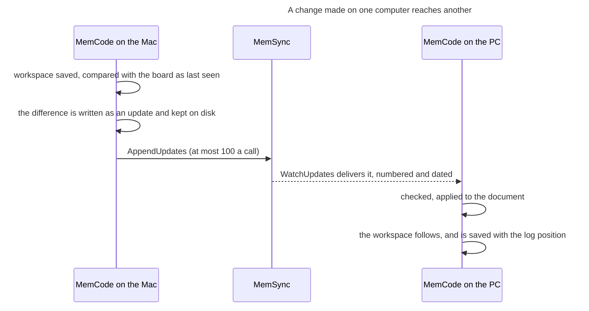

# Shared projects

MemCode can share a project through MemSync, the service that is to replace Team Sync:
start it, invite people, and keep its board the same on every computer that has it. This
page says what exists, how MemCode finds the service and how to try it on one computer.

MemSync runs at `https://sync.hosted.memtrace.io`, and memtrace.io's list of MemCode
services names it. This branch of MemCode uses it; no released MemCode does yet. Sharing
replaces Team Sync: the **Team** page in the sidebar is only shown for a project still in a
Team Sync team, so it can be managed and left, and the project menu no longer offers
**Join a team project**. The in-app guide's "Share a project" topic describes Share.

## What it does today

- Signs in to MemSync with the Memtrace account MemCode is already connected to.
- Shares the open project from a **Share** button at the top right of the project. The
  first Share or Invite starts a shared project of the same name and writes the board to
  it. Nobody is sent to a website, and nothing is set up first.
- Invites people by email, cancels an invitation, and removes a guest, for the owner.
  A guest sees who is on the project and can leave it.
- Lists, in the project switcher, the shared projects not on this computer yet and the
  invitations waiting for the person. **Open** and **Join** make a project here and give
  it the shared board.
- Keeps the board of a connected project in step with the shared project: goals, cycles,
  tasks with their runbooks, comments, lanes, custom fields and saved views. See
  [Keeping the board in step](#keeping-the-board-in-step).
- Shows what happened on a card to everyone on the project: who runs a worker on it and how
  it stands, then the summary the worker ended with, what it changed, its code review and
  the files someone shared, with who did each. The conversation is the person's own, on
  each of their computers. See [What happens on a card](#what-happens-on-a-card).

Renaming and deleting a shared project happen at memtrace.io. Workers run only on the
computer that started them. Source changes travel through Git.

A project is the thing people share. There is no team. A person's own computers are never
invited: signing in to MemCode on each is enough, and the project is then in the switcher
on each, ready to open.

## Where MemCode finds sharing

MemCode reads `https://www.memtrace.io/api/memcode/services`, the list Team Sync reads too,
and takes sharing from its `sharing` entry:

```json
{
  "version": 1,
  "sharing": {
    "endpoint": "https://sync.memtrace.io",
    "tokenEndpoint": "https://www.memtrace.io/api/memcode/memsync/token"
  }
}
```

- No `sharing` entry: sharing is not offered, and there is no Share button.
- The list is asked for without the person's sign-in, at most once a minute. When it
  cannot be read, sharing is treated as not offered until the next try, and the reason
  goes to the runtime's log on a line that starts with `[sharing]`.
- The two addresses are still checked before use. MemSync's address must be `https://`,
  or plain `http://` on this computer, because every call carries an access token. The
  token address must be at `https://www.memtrace.io` or on this computer, because the
  request carries the session's refresh token and the only session MemCode holds is a
  memtrace.io one. A self-hosted MemSync will need its own way to sign in before this rule
  can widen.
- Nothing about sharing is kept in Settings or in `workspace.json`. An earlier build kept
  two addresses there; they are dropped when MemCode starts.

For tests and a local run only, two environment variables name a MemSync and a token
address instead of the list: `MEMCODE_DEV_SHARING_SERVICE` and
`MEMCODE_DEV_SHARING_TOKEN_ADDRESS`. Both must be set. No screen offers them.

## How MemCode signs in



- The three values are the ones MemCode sends to `/api/memcode/beta/refresh`. Nothing is
  spent, so a lost reply is asked for again.
- A refresh spends the refresh token. MemCode waits for one in flight before the exchange,
  and when memtrace.io still answers 401 it looks at the session once more and tries again
  only if the refresh token has changed since.
- The token belongs to one sign-in. Signing out, or signing in as someone else, stops it
  being used at the next call.
- When MemSync turns a token away, MemCode asks for a new one and makes the call once
  more. A second refusal is shown as "did not accept this sign-in", which is what a
  signing key published in the last five minutes looks like.
- Neither the session nor a token is written to `workspace.json` or sent to the window.

## Sharing, joining and opening a project

**The Share panel.** The Share button opens a small panel on the project:

- An email field and **Invite**, for the owner. A project that is not shared yet is
  shared by the first Invite, or by Share itself on the next call that needs it.
- **People with access**: the owner, each guest, and each open invitation. The owner can
  remove a guest from the guest's menu and cancel an invitation. A guest sees the same
  people, sees how many invitations are open but not whom they are for, and can leave.
- A quiet line: "Free projects hold you and 2 guests. Your own computers don't count."
  The number is MemSync's. With every place taken, the email field is disabled.
- How the board stands, as in the table below.

The button is on every project of the person's own when sharing is offered, and not on
the example project or a project in Team Sync. Signed out, the panel asks the person to
sign in; when MemSync cannot be asked, it says why and keeps naming the shared project.

**The project switcher.** Projects shared on this computer are listed under **Shared
projects**, with a people icon. Below them come the shared projects the person is on that
are not on this computer yet, each with **Open**, and the invitations waiting for them,
each with **Join**. Join accepts the invitation and opens the project. Open and Join make
a new project here with the shared project's name and no folder, and give it the board.
Opening a shared project that is already here selects it.

**A folder.** A project made by Open or Join has no folder on this computer. Its board
says so, with **Work on this computer**, which offers the same choices as a Team project
without a folder: an existing checkout, or a clone. Workers need one; the board does not.

**Leaving.** A guest who leaves stays with the board on this computer, no longer shared.
The owner cannot leave; a project is deleted at memtrace.io.

**What is kept.** A link on this computer, in `sharedProjectLinks` in `workspace.json`:
the local project, the shared project and its name when last seen, the account that made
the link, the sharing service it lives on and when.

- A local project belongs to one shared project, and a shared project to one local
  project on a computer.
- The example project cannot be shared, and neither can a project in Team Sync. Two
  services must not both keep one board in step.
- A link whose shared project was deleted, or that was made under another account or on
  another sharing service, is shown as such in the panel, with **Stop sharing on this
  computer**. That forgets the link here and asks MemSync nothing.

## Keeping the board in step

The board the app shows is still the workspace file. For each connected project MemCode
also keeps a Yjs document, laid out as
[The board as one Yjs document](shared-board-layout-proposal.md) describes. MemSync holds
the log of changes to it and never reads one.



- **Starting.** Sync runs for a project when its link belongs to the account that is
  signed in and to the sharing service memtrace.io lists. It starts with MemCode, after
  sharing or opening a project, and when the sign-in or the service changes.
- **The first time.** You either share your own project or join someone else's and get
  their board. A computer whose board has work on it writes the board to a log that has
  none, one entry an update. A computer whose project has no work takes the board from the
  log as it is, lanes, custom fields and saved views included. When both have work,
  nothing is merged: one sentence says so, and the project stays unshared. Share and Open
  never meet this: Share starts a new shared project for the board, and Open makes a new,
  empty project. One board on two computers, with the same ids, is one board.
  Two computers that both find the log empty in the same seconds both write their board.
  That gap is known and stays for now. Closing it needs a field in MemSync.
- **Changes made here** are found after every save of the workspace, and once when sync
  starts, which is how changes made while signed out are sent later. They wait on disk
  until the log has them.
- **Changes from others** are read page by page and then from a stream that stays open.
  When the stream ends, MemCode reads on from the last entry it dealt with. A task that
  arrives never starts a worker.
- **Offline.** Changes are kept and sent when the service answers again. MemCode tries
  again after 1, 2, 5, 15, 30 and then every 60 seconds.
- **Two changes at once.** Different tasks, or different parts of one task, both stay.
  Two changes to the same field end with one of the two, the same on every computer. A
  description is merged, so edits in different places both stay.
- **An update that cannot be used** is left out and said so, and reading goes on. See the
  layout page for what that means for the changes after it.
- **Two tasks with one identifier**, as when two computers both made MC-014 while apart:
  the one that reached the log first keeps it, and the other gets the next free number.
- **A newer layout.** A board written by a newer MemCode is shown and not changed.
- **Leaving, or stopping sharing on this computer,** ends sync for that project and
  deletes what was kept for it. The board stays on the computer.

What is kept is in the profile, under `shared-boards/`, one folder per shared project:
`log.bin`, the document as the log has built it, and `sync.json`, with the log position,
the board as last seen, the changes not sent yet and the entries left out. Neither holds
a token or anything a worker wrote.

The Share panel says how the open project's board stands, under the people:

| State | What the person reads |
| --- | --- |
| Reading the log | Reading the shared board… |
| Nothing waits | The board is in sync. |
| Changes on their way | Sending 3 changes to the shared board… |
| The service cannot be reached | The reason, and "3 changes made here are kept on this computer and sent when it works again." |
| The project has work, and so has the shared board | "website already has work of its own, so it cannot join Website board: connect a project that has none yet." The panel offers **Stop sharing on this computer**. |
| A newer MemCode laid the board out | A newer MemCode laid this board out. Update MemCode to change it from this computer. Until then it is shown here and what you change stays on this computer. |
| The shared project is gone for this person | This shared project no longer exists, or you are no longer on it. |
| The workspace cannot be saved | The workspace could not be saved, so changes from the shared board are waiting. Free disk space, and they are taken up again. |

Below that line, when there is something to say: "2 changes from Dana Ek on 21 November
could not be read and were left out.", "Some changes are set aside until one they build on
arrives." and "1 value is too large for the sharing service and stays on this computer."

## What happens on a card

Each card of a shared project has an activity log at MemSync (its ADR-0014). MemSync never
reads it; what an entry holds is MemCode's (`runtime/sharing/cards/entries.ts`). Each entry
names who may read it: everyone on the project, or only the account that wrote it, on any
of its computers (MemSync's ADR-0019). MemSync enforces that: the other computers never
receive such an entry.

What a run writes, and who reads it (`readersOf` in `entries.ts`):

| Entry | Who reads it |
| --- | --- |
| The run: state, what it is doing, the harness and models | Everyone |
| The person's and the worker's turns, and why a run failed | The person's own account |
| The summary of a finished run | Everyone |
| Its code review | Everyone |
| A file someone shared, and what the run changed | Everyone |
| A message to the worker, what became of it, what the worker waits for | The person's own account |

On the computer that runs a worker on a card, MemCode writes the run to the card's log as
it happens, at most once a second. Tool output, local references and review notes stay on
the computer, and paths in a home folder and tokens are blotted out of the text.

**The summary.** Every worker's brief asks it to end with a short summary for the rest of
the project: what it did, what changed, how it checked it, and anything left open. When a
run finishes, its last message is the summary, and everyone on the project reads it.

**The changes.** When a run finishes, what it changed, as its Changes tab shows it, is
shared with the project. They are looked at again when the run's code review settles, and
shared again if they changed since. There is no button. Changes over 5 MB are not shared.

On every other computer, a card that is opened is read from its log and followed while it
is open. A run from another computer is shown with the views MemCode has for a worker
elsewhere:

- the card header says "On Mac";
- the status line above the message box says "Alex Holm · Mac" and what the worker is
  doing;
- the worker panel says SHARED, the harness and whose computer;
- the Code review tab shows the run's review, and the Changes tab what it changed.

What the Conversation tab shows depends on whose run it is:

- **Your own, from another of your computers:** the whole conversation, your turns as
  "Alex Holm · Mac", and the message box continues the worker, as the next section says.
- **Someone else's:** in place of the conversation, "Alex Holm is working on this on their
  Mac. A summary of the work shows here when it's ready for review.", then the summary
  under SUMMARY with who and when. In place of the message box: "Only Alex Holm can
  continue this worker. Comment on the card to reach them." and a **Comment** button.

A run shows only what the account that started it wrote. A turn, a summary or a review that
someone else on the project writes into it is not shown. A computer never shows its own run
back to itself, and a run started here takes over the card.

**Files are shared on purpose**, as in Team Sync. On the computer that ran the worker, the
Artifacts tab lists the card's files with a **Share** button each. A file is at most 5 MB,
and a project keeps at most 50 MB. On other computers, a shared file is listed among the
card's files with who shared it, and opening it fetches it beside the card.

What a computer sent and what still waits is in `cards.json` in the board's folder, so a
restart sends only what is new and nothing is lost offline. An entry waiting there from a
MemCode before this change is sent for its author alone. The computer's own id for card
logs is in `shared-boards/computer.json`.

**MemSync first.** A MemSync older than ADR-0019 ignores who an entry is for and gives
everything to everyone. The server at `sync.hosted.memtrace.io` must be updated before a
MemCode with this change is used on a shared project.

## Continuing a worker from another computer

A message to a worker travels in its card's log (MemSync's ADR-0015). The computer that
runs the worker, the host, decides what happens to it (ADR-0006). Only the account that
started a worker continues it: the same person on another of their computers.

**Sending.** On a card whose worker runs on another of your computers, the message box
says "Continue the worker on your Mac…". What is sent shows in the conversation with one
line for where it stands:

| Where it stands | The line |
| --- | --- |
| Not at MemSync yet | Sending… |
| In the log, the host has not read it | Sent to your Mac |
| Queued for the worker | Queued on your Mac |
| The worker took it | No line: it is part of the conversation, and the answer follows on each of your computers. |
| It could not reach the worker | Not delivered: the reason the host gave |

The same lines are in the Queue tab, where such a message cannot be edited or cancelled.

**On the host.** MemCode reads the card of every worker run here that runs now or ended in
the last three days, from where it last read, so a message sent while the host was closed
is read when it opens again, once. A message from the account that started the worker is
handled exactly as a follow-up typed on the host. A message in anyone else's name is left
alone. The host writes what became of each message into the log, for its own account.

**Answering what the worker waits for.** A question, an approval or a plan the worker waits
for is written to the card as well, for the person's own account, and shows on their other
computer in the same panel, to answer there. A question that asks for something secret is
answered on the host only: the panel says "Answer this on your Mac".

**Trust.** What became of a message, and what the worker waits for, count only when the
account that started the worker wrote them. A message is handled once, whatever the log
holds. Messages to a run on another computer are left alone.

## What a person is told

MemSync names the rule that turned a request down in `memsync-refusal` metadata. The
sentences are MemCode's own, in `src/sharing-refusals.ts`. A test fails when a rule has no
sentence.

| Rule | Sentence |
| --- | --- |
| `no_such_project` | This shared project no longer exists, or you are no longer on it. |
| `no_such_invitation` | That invitation is no longer open. Ask the owner of the project to invite you again. |
| `no_such_guest` | That person is not a guest on this project. |
| `only_the_owner_invites` | Only the owner of a project can invite people to it. |
| `not_the_owner` | Only the owner of a project can change it. |
| `the_owner_cannot_leave` | You own this project, so you cannot leave it. You can delete it at memtrace.io. |
| `guest_limit_reached` | Every guest place on this project is taken. An invitation holds its place until it is accepted, cancelled or expires. |
| `already_on_project` | You are already on this project. |
| `already_invited` | That email address already has an open invitation to this project. |
| `invitation_expired` | This invitation has expired. Ask the owner of the project to send a new one. |
| `email_not_verified` | Invitations go to a verified email address, and the one on your Memtrace account is not verified. Verify it at memtrace.io, then accept again. |
| `invalid_project_name` | A project name is one line of text, at most 240 characters long. |
| `invalid_email` | That is not an email address. Check it and try again. |
| `invalid_update_id` | MemCode sent a board change without a usable id. This is a fault in MemCode, not something you did. |
| `empty_update` | MemCode sent an empty board change. This is a fault in MemCode, not something you did. |
| `update_too_large` | One change to the board was too large to share. Shorten the text you just added and try again. |
| `too_many_updates` | MemCode sent too many board changes at once. This is a fault in MemCode, not something you did. |
| `invalid_card_id` | MemCode named a card the sharing service cannot use. This is a fault in MemCode, not something you did. |
| `file_too_large` | That file is larger than 5 MB, which is the most a project can share in one file. |
| `project_storage_full` | This project already shares 50 MB of files, which is all it can keep. The file stays on this computer. |
| `no_such_file` | That file is no longer kept for this project. Ask whoever shared it to share it again. |
| `unknown_readers` | MemCode named readers for a card entry that the sharing service does not know. This is a fault in MemCode, not something you did. |

The last four belong to the board log. MemCode is written so that it never meets them:
ids are made from the bytes, nothing empty is sent, a change is cut into pieces well under
the limit and a call holds at most 100. If the service names one anyway, sync for that
board stops with the sentence. `already_on_project` is worded for accepting, the only call
of MemCode's that can meet it.

Other problems have a sentence each as well:

| When | Sentence |
| --- | --- |
| Nobody is signed in | Sign in to Memtrace to see the projects you share. |
| memtrace.io no longer knows the session | Your Memtrace sign-in has ended. Sign in again to see the projects you share. |
| memtrace.io answers 422 | The name or email on your Memtrace account cannot be used for sharing. Change it at memtrace.io, then try again. |
| memtrace.io answers 503 | Sharing is switched off or not set up at memtrace.io right now. Try again later. |
| MemSync cannot be reached | The sharing service could not be reached. Check your connection and try again. |
| MemSync is too slow | The sharing service did not answer in time. Try again in a moment. |
| MemSync answers with trouble of its own | The sharing service is having trouble right now. Try again in a few minutes. |
| MemSync refuses the token twice | The sharing service did not accept this sign-in. Try again in a few minutes. |
| memtrace.io answers anything else, or not with a token | The sign-in for sharing answered HTTP 500. Try again later. / The sign-in for sharing did not answer with an access token. Try again later. |
| The address memtrace.io lists is not a MemSync | The address memtrace.io gave for sharing is not a sharing service. Try again later. |
| A reply cannot be read | The sharing service sent a reply MemCode could not read. Updating MemCode may help. |
| A rule MemCode does not know | The sharing service turned this down for a reason this version of MemCode does not know. Updating MemCode may help. |

The call, the status and MemSync's own words go to the runtime's log on a line that starts
with `[sharing]`.

## Where the code is

| Piece | File |
| --- | --- |
| The use cases: overview, share, invite, cancel, remove, leave, open, join, and which boards sync | `runtime/sharing/sharing.ts` |
| Requests the window may make | `runtime/sharing/routes.ts` |
| Finding MemSync in memtrace.io's list, and the developer override | `runtime/sharing/discovery.ts` |
| The two addresses and their rules | `runtime/sharing/addresses.ts` |
| The access token: exchange, renewal, one retry | `runtime/sharing/access.ts` |
| The session shown to memtrace.io | `sessionProof` in `runtime/beta.ts` |
| Problems a person can be told about | `runtime/sharing/problems.ts` |
| MemSync's Projects API as MemCode uses it | `runtime/sharing/memsync/projects-api.ts` |
| MemSync's Boards API as MemCode uses it | `runtime/sharing/memsync/boards-api.ts` |
| A call signed with the access token, once more when the token is refused | `runtime/sharing/memsync/signed-calls.ts` |
| Board sync for one project: reading, sending, bringing two boards together | `runtime/sharing/board/sync.ts` |
| The board as a Yjs document | `runtime/sharing/board/document.ts` |
| What of a project is on the board, and what a board means for the project | `runtime/sharing/board/board.ts` |
| Update ids, the check before applying, what a document holds beyond the log | `runtime/sharing/board/updates.ts` |
| Who keeps an identifier two tasks share | `runtime/sharing/board/identifiers.ts` |
| What a connected project keeps on disk | `runtime/sharing/board/store.ts` |
| How a board stands, in words | `src/sharing-board.ts` |
| What MemCode writes into a card's log | `runtime/sharing/cards/entries.ts` |
| Writing this computer's runs, following an open card, sending and hosting messages to workers | `runtime/sharing/cards/activity.ts` |
| Where a message to a worker stands, in words; what a worker waits for, as shared | `runtime/sharing/cards/worker-messages.ts` |
| Allow and Decline on the host's card. Nothing reaches it since only a worker's own account continues it; it is to be removed | `src/components/WorkerAsks.tsx` |
| Which of a task's files may be shared | `runtime/sharing/cards/files.ts` |
| MemSync's Cards API as MemCode uses it | `runtime/sharing/memsync/cards-api.ts`, `cards-contract.ts`, `cards.proto` |
| A run from a card's log, in the shape the card's views take, and what someone else's run says in place of its conversation | `src/sharing-cards.ts` |
| Someone else's run: how it stands, then its summary | `src/components/SharedRunSummary.tsx` |
| The Share buttons on a card's files | `src/components/ShareFromCard.tsx` |
| gRPC over Node's own HTTP/2 | `runtime/sharing/memsync/grpc.ts` |
| Protocol Buffers on the wire | `runtime/sharing/memsync/wire.ts` |
| The contract, and the part of it MemCode uses | `runtime/sharing/memsync/projects.proto`, `projects-contract.ts`, `boards.proto`, `boards-contract.ts` |
| Rule names and sentences | `src/sharing-refusals.ts` |
| What the window knows of sharing | `src/sharing.ts` |
| The Share button and panel, the switcher's shared projects, the folder notice | `src/components/ShareProject.tsx` |

MemCode makes nine of the eleven Projects calls: `StartProject`, `ListProjects`,
`GetProject`, `InvitePerson`, `ListInvitations`, `AcceptInvitation`, `CancelInvitation`,
`RemoveGuest` and `LeaveProject`. Renaming and deleting stay at memtrace.io. It makes all
three Boards calls, `AppendUpdates`, `ReadUpdates` and
`WatchUpdates`, and all five Cards calls. A Cards reply can be 6 MiB, so the client takes
replies that large.

One package was added: `yjs` 13.6.33, with `lib0` and `isomorphic.js` that it needs. They
are in the lock file and in the third-party notices. The gRPC client is still MemCode's
own, over `node:http2`, because the app otherwise has no gRPC dependency. The contract
files are written by hand; `tests/sharing-wire.test.ts` reads the `.proto` files and fails
when the two disagree, and checks the codec against bytes made by `protoc`.

### When the contract changes

`runtime/sharing/memsync/projects.proto` and `boards.proto` are copies of the files in
`proto/memsync/v1/` in the `memsync` repository, taken on 21 November 2026. Copy the newer
file over it and run:

```sh
node --import tsx --test tests/sharing-wire.test.ts
```

The test names every message and call that no longer matches.

## Checks

```sh
node --import tsx --test tests/sharing*.test.ts
```

One file runs MemCode's client against a real `memsync-server`. It is skipped unless both
variables are set:

```sh
MEMSYNC_SERVER_BINARY=/path/to/memsync/target/release/memsync-server MEMSYNC_TEST_DATABASE_URL=postgres://memsync@127.0.0.1:54329/postgres node --import tsx --test tests/sharing-real-memsync.test.ts
```

`MEMSYNC_TEST_DATABASE_URL` names a PostgreSQL server where tests may create databases,
as in the `memsync` repository. The test makes a database of its own with `psql` and drops
it, so nothing that already exists there is touched. Never point it at a server that holds
real data. `MEMSYNC_TEST_PSQL` names another `psql` when the one on the PATH will not do.

The same scenarios run against a stand-in service in `tests/support/memsync-stand-in.ts`
on every `npm test`. Twelve of the thirteen project rules are reached against the real
server. `invitation_expired` is reached only on the stand-in, where days can be made to
pass.

Board sync has nine scenarios with two computers that run against both: a board written
out and taken by a second computer, a goal, a cycle and a task made on one showing on the
other while both run, changes in both directions, offline and a restart,
changes made while sync was not running, two boards that stay two, two tasks numbered
alike, and a guest who is taken off the project. Sixteen more run against the stand-in only,
most because they need a service that can be made to misbehave: an answer that is lost,
an update damaged in the log, bytes that are not what their id says, an update that reads
and cannot be applied, a newer layout, a change the service refuses, a call it never
answers, MemCode stopped before and after the workspace file was written, a full disk and
a stream that is cut. `tests/sharing-runtime.test.ts` runs two whole runtimes against the
stand-in, through the same requests the window makes.

43 deliberate breakages of board sync were run against these tests. 42 make a test fail.
One is not caught: the line in `runtime/app.ts` that hands board sync the workspace save.
What that line relies on, that `LocalStore.save` reads the workspace at the call and
writes it after the step it is given, is covered in `tests/sharing-workspace-save.test.ts`.

What happens on a card has five Cards client scenarios and eight card activity scenarios,
which run against the stand-in and against a real `memsync-server` that serves Cards
(the one built on 22 November does): entries numbered and signed per card, a watched card,
a 5 MB file in one reply, every refusal by its rule name, the 50 MB limit; a run shown live
on the other computer with who runs it, only what changed sent again, the review, a turn
and a review forged by a guest not shown, the same person on two computers, offline and a
restart, a shared file, and a task whose id is not a UUID.

Continuing a worker from another computer has seven more card activity scenarios, against
both: the person's own follow-up taken at once and answered on both computers, someone
else's waiting until allowed, one declined, a delivery forged by a guest not believed, a
message sent while the host was closed taken once when it opens (and once again even when
read from the start), a question answered from the other computer with a secret one kept
to the host, and a sender who joined after the host last looked named rather than called
"someone". Two whole runtimes check that a follow-up typed on the PC is queued for the
Mac's worker and shown on the PC as "Queued on your Mac".

## Trying it on one computer

`scripts/shared-projects-local.mts` runs the real runtime and the real app window in a
browser, signed in through a memtrace.io on the same computer.

What is real: the runtime, its beta sign-in and refresh, the token exchange, the calls to
`memsync-server` and the app's own screens. What stands in: the native shell, whose calls
the script answers; the person in the browser, whose approval the script gives with a
session cookie; and the code engine, which is switched off so that nothing is downloaded
and no installed Memtrace is touched.

1. Start a throwaway PostgreSQL and create two databases, one for the site and one for
   MemSync.
2. Run memtrace.io from a branch that has `POST /api/memcode/memsync/token`, with
   `MEMCODE_BETA_ENABLED=1` and a signing key. The `memtrace` repository describes this in
   `memtrace-ui/docs/memsync-access-tokens.md` and `memcode-projects.md`.
3. Start `memsync-server` after the site, with `MEMSYNC_TOKEN_KEYS_URL` set to the site's
   `/api/memcode/jwks`.
4. Give the site a signed-in, approved person: a `user`, an approved `app_users` row and a
   `session`, as `e2e/seed.mjs` in `memtrace-ui` does. Their signed session cookie is what
   the script needs.
5. Start MemCode:

   ```sh
   MEMCODE_LOCAL_SITE=http://127.0.0.1:3000 MEMCODE_LOCAL_SITE_COOKIE=<cookie value> node --import tsx scripts/shared-projects-local.mts --port 5310
   ```

6. Open the address it prints and choose **Connect Memtrace beta** under Account in
   Settings.

The script sends MemCode's requests to memtrace.io to the local site, so MemCode finds
MemSync in the site's `/api/memcode/services`. Give that list a `sharing` entry with the
local MemSync and `http://localhost:<site port>/api/memcode/memsync/token`. Or start the
script with `MEMCODE_DEV_SHARING_SERVICE` and `MEMCODE_DEV_SHARING_TOKEN_ADDRESS` set.

Click **Share** and invite someone. A second run on another port, with another
`--profile` folder, is a second computer: sign it in as the same person and **Open** the
project from the switcher, and what is done on one board shows on the other. A run with
another person's cookie is a guest's computer: the invitation is in its switcher, with
**Join**.

Stopping `memsync-server` shows the offline line and the count of changes that wait.
Starting it again sends them, within a minute.

To try what happens on a card without running a model, start the computer that runs the
worker with `--stand-in-worker`. It answers follow-ups by itself, from this computer or
another, a couple of seconds after they are picked up. It also adds `POST /dev/worker-turn`,
which plays a worker on a task: `{ "taskId": "…", "text": "…", "state": "running" | "finished", "file": { "name":
"report.html", "text": "…" } }`. Open the card on the other computer and watch it follow.
In this browser run an HTML file shows a blank preview on both computers: the native shell
draws HTML previews, and the script stands in for it.

## Choices that are not confirmed

1. **Where sharing sits.** A Share button at the top right of a project, with the
   people on it beside it, and shared projects and invitations in the project switcher.
   No sidebar entry and no Settings fields.
2. **MemCode finds MemSync in memtrace.io's list of services**, asked at most once a
   minute. A list that cannot be read means no Share button until the next try.
3. **The sign-in address must be at www.memtrace.io or on this computer.**
4. **No new package.** gRPC and Protocol Buffers are written against Node's own HTTP/2,
   and checked against the `.proto` file. The website uses Connect.
5. **One local project per shared project on a computer, and one shared project per local
   project.**
6. **A project in Team Sync cannot be shared** until it has left its team.
7. **Share starts a shared project with the local project's name.** There is no step to
   name it, and nothing to confirm before the first invitation goes.
8. **The window is given names and account ids**, the ids so the owner can remove a
   guest. Whom an invitation is for is shown to the owner only; a guest sees how many are
   open.
9. **Every sentence** on this page and on the screens.
10. **Ten seconds** of patience for a MemSync call and fifteen for the token exchange.
11. **A token is renewed a minute before it expires**, or at half its life when it lives
    under two minutes.
12. **Open and Join make a project with no folder.** The board works at once; a folder is
    chosen when someone wants workers here.
13. **The local-run script is in the repository**, with a stand-in for the native shell.

For board sync, beside what the [layout page](shared-board-layout-proposal.md) holds:

14. **Sync starts by itself** for every shared project. There is no switch per project.
15. **Where the board is kept on disk**: `shared-boards/` in the profile.
16. **Where a project and the log hold an entry with the same id, the log's is taken.**
    That is one board on two computers, or a project that is connected again.
17. **Sharing waits up to eight seconds** for board sync to say how the two boards stand,
    and takes the link back when both have work. When the service cannot be asked in
    that time, the link stays and the Share panel says it later.
18. **A project that joins takes the board's lanes, custom fields and saved views** in
    place of its own.
19. **How long MemCode waits before trying again**: 1, 2, 5, 15, 30, then 60 seconds.
20. **A comment in a shared project is by the Memtrace account**, with the name the
    sharing service has for it. Before, it was by "You".
21. **A task that a worker on this computer is on is not taken off the board here** when
    someone else deletes it. It is back for everyone once it changes here.
22. **Every sentence** in the table of states above.

For what happens on a card:

23. **A card is read when it is opened and followed while open**, not for every card all
    the time. The board does not show who is running what across the project.
24. **Files are shared with one click each**, not on their own, as in Team Sync. A run's
    changes are shared when it finishes, as a file of the Changes tab's own format, not a
    Git patch.
25. **A run's turns and review count only from the account that wrote its first entry.**
26. **The person's turns of a run from elsewhere carry the run owner's name.**
27. **This computer is named by its kind, "Mac", "Windows" or "Linux"**, never its host name.
28. **A run is written at most once a second**, so a long streamed answer is sent a few
    times over as it grows.
29. **Only the person who runs a worker reads its conversation** (Alex, 23 November 2026:
    "I can't see what the agents has been had conversations about" in Linear). Everyone
    else reads how it stands and its summary. Why a run failed is the person's too.
30. **The summary is the run's last message**, which the brief asks to be a summary. It
    is not written by another model.
31. **A run's changes are looked at when it ends and when its code review settles**, not
    on every save.

For continuing a worker from another computer:

32. **The host reads the cards of workers that run now or ended in the last three days.**
    A message to an older run waits until it is run again.
33. **No one-time approval for a person's own second computer.** Signing in to the same
    account on both is the approval, as ADR-0015 says.
34. **Nobody else continues a worker**, not even after its person allows it. A guest
    comments on the card.
35. **A message sent from another computer cannot be edited or cancelled**: the log keeps
    what was written.
36. **A secret answer never travels.** The question shows; it is answered on the host.

## Not built

- **Claims, and who is running what across the project.** A person sees who runs a worker
  on a card when they open it.
- **Starting a new worker on someone else's computer.** A message continues a worker that
  ran there; it does not start one.
- **Hiding a review or a file that someone else on the project shared into a card.** A
  file shows who shared it; it is not refused.
- What the [layout page](shared-board-layout-proposal.md#not-built) lists for the board.
- Anything for organization projects. MemSync has none yet.
- Moving a Team Sync project to a shared project.
- Renaming or deleting a shared project from MemCode. Both are at memtrace.io.
- A notice in the app when an invitation arrives. The switcher shows it when opened.
- Taking back a shared project that Share started when writing its board then failed. It
  stays at MemSync, empty, and the next Share starts another.
